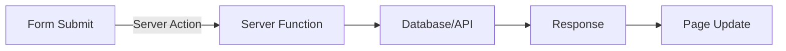

# Day 13: Server Actions & Forms

## 📚 Aaj Kya Seekhoge?
- Server Actions kya hain
- Forms with Server Actions
- Form validation
- Mutations in Server Components

---

## 🔄 Server Actions Overview



---

## 📝 Basic Server Action

```tsx
// app/contact/page.tsx
export default function ContactPage() {
  async function handleSubmit(formData: FormData) {
    'use server';
    
    const name = formData.get('name') as string;
    const email = formData.get('email') as string;
    const message = formData.get('message') as string;
    
    console.log({ name, email, message });
    // Save to database
  }
  
  return (
    <div className="max-w-2xl mx-auto p-4">
      <h1 className="text-3xl font-bold mb-6">Contact Us</h1>
      <form action={handleSubmit} className="space-y-4">
        <div>
          <label className="block text-sm font-medium mb-1">Name</label>
          <input 
            type="text" 
            name="name"
            className="w-full border rounded-lg px-4 py-2"
            required
          />
        </div>
        <div>
          <label className="block text-sm font-medium mb-1">Email</label>
          <input 
            type="email" 
            name="email"
            className="w-full border rounded-lg px-4 py-2"
            required
          />
        </div>
        <div>
          <label className="block text-sm font-medium mb-1">Message</label>
          <textarea 
            name="message"
            rows={4}
            className="w-full border rounded-lg px-4 py-2"
            required
          />
        </div>
        <button 
          type="submit"
          className="bg-blue-500 text-white px-6 py-2 rounded-lg"
        >
          Send Message
        </button>
      </form>
    </div>
  );
}
```

---

## 🔄 Using External Server Action File

```tsx
// app/actions.ts
'use server';

export async function createUser(formData: FormData) {
  const name = formData.get('name') as string;
  const email = formData.get('email') as string;
  
  // Validate
  if (!name || !email) {
    return { error: 'Name and email are required' };
  }
  
  // Save to database
  const user = { id: Date.now(), name, email };
  
  return { success: true, user };
}

export async function deletePost(id: number) {
  // Delete from database
  console.log('Deleting post:', id);
  return { success: true };
}
```

```tsx
// app/create/page.tsx
import { createUser } from '../actions';

export default function CreatePage() {
  return (
    <form action={createUser} className="p-4">
      <input type="text" name="name" placeholder="Name" className="border p-2" />
      <input type="email" name="email" placeholder="Email" className="border p-2" />
      <button type="submit" className="bg-blue-500 text-white px-4 py-2">
        Create User
      </button>
    </form>
  );
}
```

---

## 📋 Form with Multiple Actions

```tsx
// app/todos/page.tsx
import { addTodo, deleteTodo } from './actions';

async function getTodos() {
  // Fetch from database
  return [
    { id: 1, text: 'Learn Next.js', completed: false },
    { id: 2, text: 'Build a project', completed: false },
  ];
}

export default async function TodosPage() {
  const todos = await getTodos();
  
  return (
    <div className="max-w-2xl mx-auto p-4">
      <h1 className="text-3xl font-bold mb-6">Todos</h1>
      
      {/* Add Todo Form */}
      <form action={addTodo} className="flex gap-2 mb-6">
        <input 
          type="text" 
          name="text"
          placeholder="Add todo..."
          className="flex-1 border rounded-lg px-4 py-2"
          required
        />
        <button 
          type="submit"
          className="bg-blue-500 text-white px-6 py-2 rounded-lg"
        >
          Add
        </button>
      </form>
      
      {/* Todo List */}
      <div className="space-y-2">
        {todos.map((todo) => (
          <div key={todo.id} className="flex items-center gap-2 bg-white p-4 rounded-lg shadow">
            <span className="flex-1">{todo.text}</span>
            <form action={deleteTodo}>
              <input type="hidden" name="id" value={todo.id} />
              <button 
                type="submit"
                className="text-red-500 hover:text-red-700"
              >
                Delete
              </button>
            </form>
          </div>
        ))}
      </div>
    </div>
  );
}
```

---

## ✅ Form Validation

```tsx
// app/actions.ts
'use server';

export async function registerUser(formData: FormData) {
  const name = formData.get('name') as string;
  const email = formData.get('email') as string;
  const password = formData.get('password') as string;
  
  const errors: Record<string, string> = {};
  
  if (!name || name.length < 2) {
    errors.name = 'Name must be at least 2 characters';
  }
  
  if (!email || !email.includes('@')) {
    errors.email = 'Invalid email address';
  }
  
  if (!password || password.length < 6) {
    errors.password = 'Password must be at least 6 characters';
  }
  
  if (Object.keys(errors).length > 0) {
    return { errors };
  }
  
  // Save to database
  return { success: true };
}
```

---

## 🎯 Aaj Ka Summary

| Concept | Code | Use Case |
|---------|------|----------|
| Server Action | `'use server'` | Server-side logic |
| Form Action | `action={serverAction}` | Form handling |
| FormData | `formData.get('name')` | Get form values |
| Validation | Manual checks | Form validation |

---

## ✅ Next Steps
- Kal hum **API Routes** seekhenge
- Aaj ke practice problems solve karo
