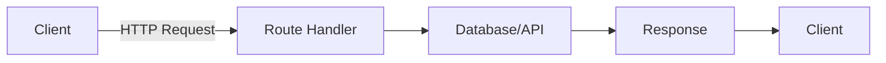

# Day 14: API Routes

## 📚 Aaj Kya Seekhoge?
- Route Handlers
- GET, POST, PUT, DELETE
- Query parameters
- Request/Response objects

---

## 🔌 Route Handlers



---

## 📁 API Route Structure

```
app/
├── api/
│   └── users/
│       ├── route.ts      → /api/users
│       └── [id]/
│           └── route.ts  → /api/users/:id
```

---

## 📡 GET Request

```tsx
// app/api/users/route.ts
import { NextResponse } from 'next/server';

export async function GET() {
  const users = [
    { id: 1, name: 'Mahroosh' },
    { id: 2, name: 'Ali' },
  ];
  
  return NextResponse.json(users);
}
```

---

## 📤 POST Request

```tsx
// app/api/users/route.ts
import { NextRequest, NextResponse } from 'next/server';

export async function POST(request: NextRequest) {
  const body = await request.json();
  
  const newUser = {
    id: Date.now(),
    name: body.name,
    email: body.email,
  };
  
  return NextResponse.json(newUser, { status: 201 });
}
```

---

## 🔄 PUT & DELETE

```tsx
// app/api/users/[id]/route.ts
import { NextRequest, NextResponse } from 'next/server';

export async function GET(
  request: NextRequest,
  { params }: { params: Promise<{ id: string }> }
) {
  const { id } = await params;
  return NextResponse.json({ id, name: 'User' });
}

export async function PUT(
  request: NextRequest,
  { params }: { params: Promise<{ id: string }> }
) {
  const { id } = await params;
  const body = await request.json();
  
  return NextResponse.json({ id, ...body });
}

export async function DELETE(
  request: NextRequest,
  { params }: { params: Promise<{ id: string }> }
) {
  const { id } = await params;
  
  return NextResponse.json({ message: `User ${id} deleted` });
}
```

---

## 🔍 Query Parameters

```tsx
// app/api/search/route.ts
import { NextRequest, NextResponse } from 'next/server';

export async function GET(request: NextRequest) {
  const searchParams = request.nextUrl.searchParams;
  const query = searchParams.get('q');
  const page = searchParams.get('page') || '1';
  
  return NextResponse.json({ query, page });
}

// Usage: /api/search?q=nextjs&page=2
```

---

## 📝 Complete API Example

```tsx
// app/api/todos/route.ts
import { NextRequest, NextResponse } from 'next/server';

let todos = [
  { id: 1, text: 'Learn Next.js', completed: false },
  { id: 2, text: 'Build a project', completed: true },
];

export async function GET() {
  return NextResponse.json(todos);
}

export async function POST(request: NextRequest) {
  const body = await request.json();
  
  const newTodo = {
    id: Date.now(),
    text: body.text,
    completed: false,
  };
  
  todos.push(newTodo);
  return NextResponse.json(newTodo, { status: 201 });
}

// app/api/todos/[id]/route.ts
import { NextRequest, NextResponse } from 'next/server';

export async function PATCH(
  request: NextRequest,
  { params }: { params: Promise<{ id: string }> }
) {
  const { id } = await params;
  const body = await request.json();
  
  todos = todos.map(todo => 
    todo.id === Number(id) ? { ...todo, ...body } : todo
  );
  
  return NextResponse.json({ message: 'Updated' });
}

export async function DELETE(
  request: NextRequest,
  { params }: { params: Promise<{ id: string }> }
) {
  const { id } = await params;
  todos = todos.filter(todo => todo.id !== Number(id));
  
  return NextResponse.json({ message: 'Deleted' });
}
```

---

## 🎯 Aaj Ka Summary

| Method | Function | Use Case |
|--------|----------|----------|
| GET | `GET()` | Read data |
| POST | `POST()` | Create data |
| PUT | `PUT()` | Update data |
| DELETE | `DELETE()` | Delete data |

---

## ✅ Next Steps
- Kal hum **Phase 2 Revision** karenge
- Aaj ke practice problems solve karo
