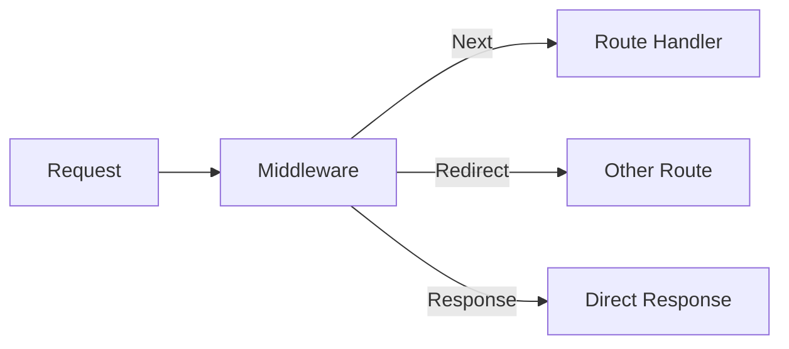

# Day 15: Middleware

## 📚 Aaj Kya Seekhoge?
- Middleware kya hai
- Request/Response modification
- Authentication check
- Redirects

---

## 🔧 Middleware Overview



---

## 📁 Middleware File

```
project/
├── middleware.ts    (Root level, NOT in app/)
├── app/
│   ├── page.tsx
│   └── dashboard/
│       └── page.tsx
```

---

## 📝 Basic Middleware

```tsx
// middleware.ts
import { NextResponse } from 'next/server';
import type { NextRequest } from 'next/server';

export function middleware(request: NextRequest) {
  console.log('Middleware running for:', request.nextUrl.pathname);
  
  return NextResponse.next();
}

export const config = {
  matcher: '/dashboard/:path*',
};
```

---

## 🔐 Auth Middleware

```tsx
// middleware.ts
import { NextResponse } from 'next/server';
import type { NextRequest } from 'next/server';

export function middleware(request: NextRequest) {
  const token = request.cookies.get('token')?.value;
  
  const isProtectedRoute = request.nextUrl.pathname.startsWith('/dashboard');
  
  if (isProtectedRoute && !token) {
    return NextResponse.redirect(new URL('/login', request.url));
  }
  
  return NextResponse.next();
}

export const config = {
  matcher: ['/dashboard/:path*', '/profile/:path*'],
};
```

---

## 🔄 Conditional Redirects

```tsx
// middleware.ts
import { NextResponse } from 'next/server';
import type { NextRequest } from 'next/server';

export function middleware(request: NextRequest) {
  const pathname = request.nextUrl.pathname;
  
  // Redirect old URLs
  if (pathname === '/old-page') {
    return NextResponse.redirect(new URL('/new-page', request.url));
  }
  
  // Maintenance mode
  if (pathname.startsWith('/admin')) {
    const isAdmin = request.cookies.get('admin')?.value === 'true';
    if (!isAdmin) {
      return NextResponse.redirect(new URL('/login', request.url));
    }
  }
  
  return NextResponse.next();
}

export const config = {
  matcher: ['/old-page', '/admin/:path*'],
};
```

---

## 🎯 Aaj Ka Summary

| Concept | Code | Use Case |
|---------|------|----------|
| File | `middleware.ts` | Root level |
| Matcher | `config.matcher` | Route matching |
| Redirect | `NextResponse.redirect()` | Auth/URL changes |
| Next | `NextResponse.next()` | Continue |

---

## ✅ Next Steps
- Kal hum **Forms & Validation** seekhenge
- Aaj ke practice problems solve karo
