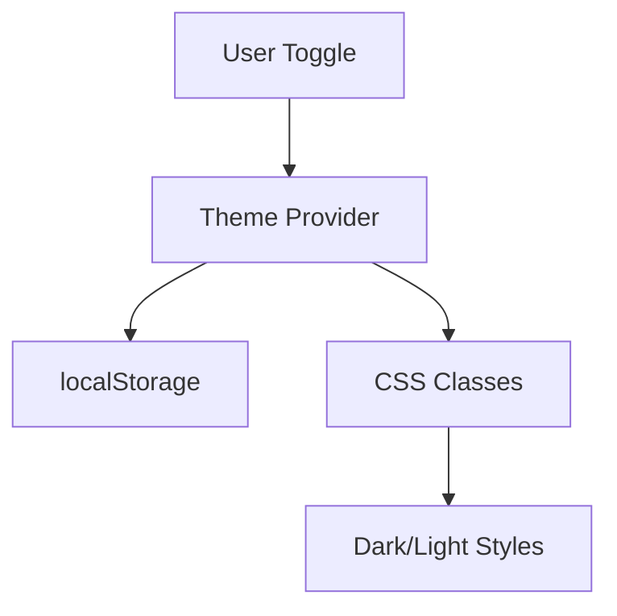

# Day 17: Dark Mode

## 📚 Aaj Kya Seekhoge?
- Dark mode toggle
- Theme providers
- System preference detection
- Persist theme

---

## 🌙 Dark Mode Setup



---

## 📝 Basic Dark Mode

```tsx
// app/components/ThemeProvider.tsx
"use client";

import { createContext, useContext, useEffect, useState } from 'react';

type Theme = 'light' | 'dark';

const ThemeContext = createContext<{
  theme: Theme;
  toggle: () => void;
}>({
  theme: 'light',
  toggle: () => {},
});

export function useTheme() {
  return useContext(ThemeContext);
}

export function ThemeProvider({ children }: { children: React.ReactNode }) {
  const [theme, setTheme] = useState<Theme>('light');
  
  useEffect(() => {
    const saved = localStorage.getItem('theme') as Theme;
    if (saved) {
      setTheme(saved);
    } else if (window.matchMedia('(prefers-color-scheme: dark)').matches) {
      setTheme('dark');
    }
  }, []);
  
  useEffect(() => {
    localStorage.setItem('theme', theme);
    document.documentElement.classList.toggle('dark', theme === 'dark');
  }, [theme]);
  
  const toggle = () => setTheme(theme === 'light' ? 'dark' : 'light');
  
  return (
    <ThemeContext.Provider value={{ theme, toggle }}>
      {children}
    </ThemeContext.Provider>
  );
}
```

---

## 🎨 Dark Mode Component

```tsx
// app/components/ThemeToggle.tsx
"use client";

import { useTheme } from './ThemeProvider';

export default function ThemeToggle() {
  const { theme, toggle } = useTheme();
  
  return (
    <button 
      onClick={toggle}
      className="p-2 rounded-lg bg-gray-200 dark:bg-gray-700"
    >
      {theme === 'light' ? '🌙' : '☀️'}
    </button>
  );
}
```

---

## 🌓 Tailwind Dark Mode

```tsx
// tailwind.config.ts
export default {
  darkMode: 'class',
  // ...
}

// Usage:
<div className="bg-white dark:bg-gray-900 text-black dark:text-white">
  <h1 className="text-gray-900 dark:text-white">Title</h1>
  <p className="text-gray-600 dark:text-gray-400">Text</p>
</div>
```

---

## 📝 Complete Dark Mode Example

```tsx
// app/layout.tsx
import { ThemeProvider } from './components/ThemeProvider';

export default function RootLayout({ children }: { children: React.ReactNode }) {
  return (
    <html lang="en" suppressHydrationWarning>
      <body>
        <ThemeProvider>
          {children}
        </ThemeProvider>
      </body>
    </html>
  );
}

// app/page.tsx
"use client";

import ThemeToggle from './components/ThemeToggle';

export default function HomePage() {
  return (
    <div className="min-h-screen bg-white dark:bg-gray-900 text-black dark:text-white">
      <nav className="p-4 flex justify-between items-center border-b dark:border-gray-700">
        <h1 className="text-xl font-bold">My App</h1>
        <ThemeToggle />
      </nav>
      <main className="p-4">
        <h2 className="text-3xl font-bold mb-4">Welcome!</h2>
        <p className="text-gray-600 dark:text-gray-400">
          This is a dark mode example.
        </p>
      </main>
    </div>
  );
}
```

---

## 🎯 Aaj Ka Summary

| Concept | Code | Use Case |
|---------|------|----------|
| Provider | `ThemeProvider` | Theme state |
| Toggle | `useTheme()` | Switch theme |
| Classes | `dark:` | Dark styles |
| Persist | `localStorage` | Remember choice |

---

## ✅ Next Steps
- Kal hum **Streaming & Suspense** seekhenge
- Aaj ke practice problems solve karo
