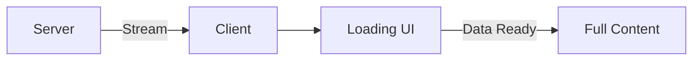

# Day 18: Streaming & Suspense

## 📚 Aaj Kya Seekhoge?
- Streaming kya hai
- Suspense boundaries
- Loading states
- Parallel data fetching

---

## 🔄 Streaming Overview



---

## ⏳ Basic Suspense

```tsx
// app/dashboard/page.tsx
import { Suspense } from 'react';

async function SlowComponent() {
  await new Promise(resolve => setTimeout(resolve, 3000));
  return <div>Content loaded!</div>;
}

export default function DashboardPage() {
  return (
    <div>
      <h1>Dashboard</h1>
      <Suspense fallback={<div className="animate-pulse">Loading...</div>}>
        <SlowComponent />
      </Suspense>
    </div>
  );
}
```

---

## 📊 Parallel Data Fetching

```tsx
// app/dashboard/page.tsx
import { Suspense } from 'react';

async function Stats() {
  const res = await fetch('https://api.example.com/stats');
  const data = await res.json();
  return <div>Stats: {data.value}</div>;
}

async function RecentPosts() {
  const res = await fetch('https://api.example.com/posts');
  const posts = await res.json();
  return (
    <ul>
      {posts.map((post: any) => <li key={post.id}>{post.title}</li>)}
    </ul>
  );
}

export default function DashboardPage() {
  return (
    <div className="grid grid-cols-2 gap-4">
      <Suspense fallback={<div className="h-32 bg-gray-200 animate-pulse rounded"></div>}>
        <Stats />
      </Suspense>
      <Suspense fallback={<div className="h-32 bg-gray-200 animate-pulse rounded"></div>}>
        <RecentPosts />
      </Suspense>
    </div>
  );
}
```

---

## 🎯 Aaj Ka Summary

| Concept | Code | Use Case |
|---------|------|----------|
| Suspense | `<Suspense>` | Loading boundary |
| Fallback | `fallback={<Loading />}` | Loading UI |
| Streaming | Auto | Progressive loading |

---

## ✅ Next Steps
- Kal hum **Error Handling** seekhenge
- Aaj ke practice problems solve karo
