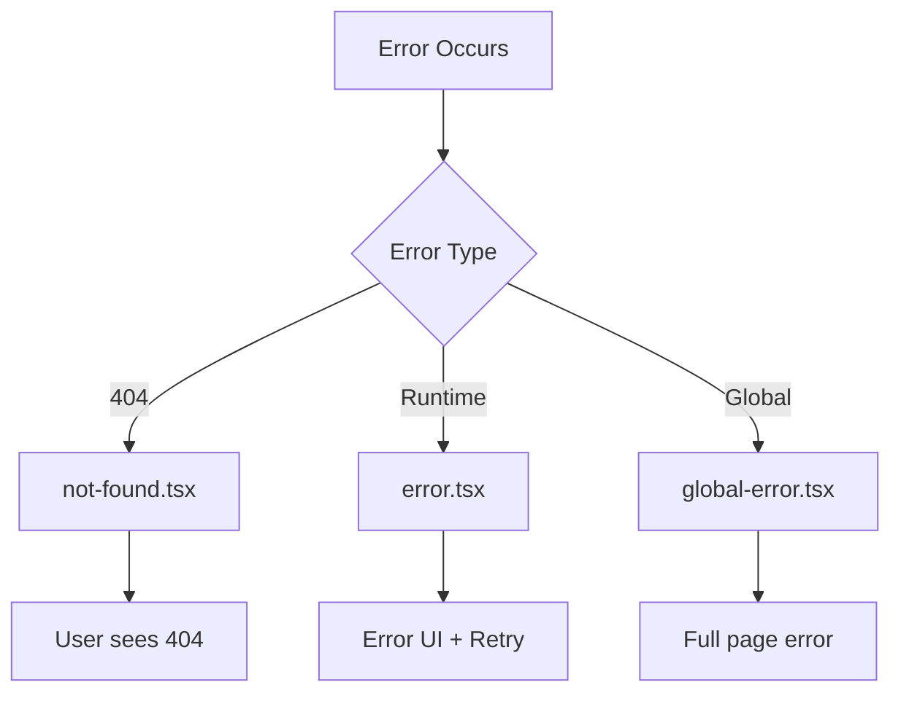

# Day 19: Error Handling

## 📚 Aaj Kya Seekhoge?
- Error boundaries
- Not Found pages
- Error recovery
- Global errors

---

## ❌ Error Handling Overview



---

## 📝 Basic Error Boundary

```tsx
// app/dashboard/error.tsx
"use client";

export default function DashboardError({
  error,
  reset,
}: {
  error: Error & { digest?: string };
  reset: () => void;
}) {
  return (
    <div className="min-h-[400px] flex items-center justify-center">
      <div className="text-center">
        <div className="text-6xl mb-4">💥</div>
        <h2 className="text-2xl font-bold mb-2">Something went wrong!</h2>
        <p className="text-gray-600 mb-6">{error.message}</p>
        <div className="flex gap-4 justify-center">
          <button 
            onClick={reset}
            className="bg-blue-500 text-white px-6 py-2 rounded"
          >
            Try again
          </button>
          <a 
            href="/"
            className="bg-gray-200 text-gray-800 px-6 py-2 rounded"
          >
            Go Home
          </a>
        </div>
      </div>
    </div>
  );
}
```

---

## 🔍 Not Found Page

```tsx
// app/not-found.tsx
import Link from 'next/link';

export default function NotFound() {
  return (
    <div className="min-h-[400px] flex items-center justify-center">
      <div className="text-center">
        <div className="text-8xl mb-4">🔍</div>
        <h1 className="text-6xl font-bold mb-4">404</h1>
        <h2 className="text-2xl mb-8">Page Not Found</h2>
        <Link 
          href="/"
          className="bg-blue-500 text-white px-8 py-3 rounded-lg"
        >
          Go Home
        </Link>
      </div>
    </div>
  );
}
```

---

## 🌐 Global Error

```tsx
// app/global-error.tsx
"use client";

export default function GlobalError({
  error,
  reset,
}: {
  error: Error & { digest?: string };
  reset: () => void;
}) {
  return (
    <html>
      <body>
        <div className="min-h-screen flex items-center justify-center">
          <div className="text-center">
            <h2 className="text-2xl font-bold mb-4">Global Error!</h2>
            <button onClick={reset} className="bg-blue-500 text-white px-4 py-2 rounded">
              Try again
            </button>
          </div>
        </div>
      </body>
    </html>
  );
}
```

---

## 🎯 Aaj Ka Summary

| File | Purpose |
|------|---------|
| `error.tsx` | Route error boundary |
| `not-found.tsx` | 404 page |
| `global-error.tsx` | Root layout error |

---

## ✅ Next Steps
- Kal hum **Caching** seekhenge
- Aaj ke practice problems solve karo
