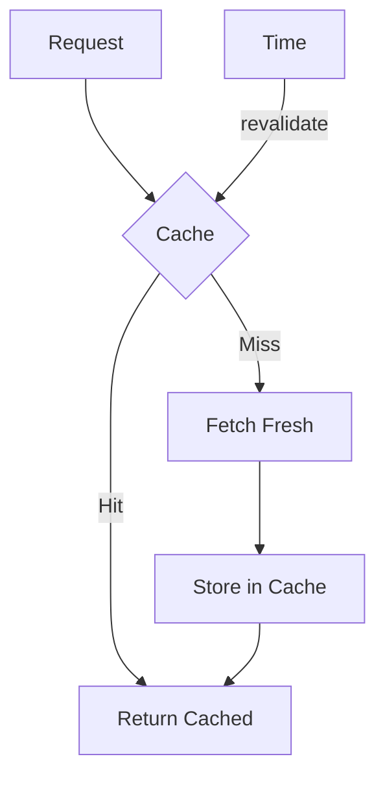

# Day 20: Caching Strategies

## 📚 Aaj Kya Seekhoge?
- Next.js caching
- Revalidation strategies
- Static vs Dynamic
- Cache tags

---

## 🔄 Caching Overview



---

## 📝 Cache Options

```tsx
// 1. Static (Default) - Cached forever
const res = await fetch('https://api.example.com/data');

// 2. Time-based revalidation
const res = await fetch('https://api.example.com/data', {
  next: { revalidate: 3600 } // Revalidate every hour
});

// 3. No cache - Always fresh
const res = await fetch('https://api.example.com/data', {
  cache: 'no-store'
});

// 4. Tag-based revalidation
const res = await fetch('https://api.example.com/data', {
  next: { tags: ['posts'] }
});
```

---

## 🏷️ Cache Tags

```tsx
// Fetch with tags
const res = await fetch('https://api.example.com/posts', {
  next: { tags: ['posts'] }
});

// Revalidate by tag (in API route or Server Action)
import { revalidateTag } from 'next/cache';

export async function updatePost() {
  // Update database...
  revalidateTag('posts');
}
```

---

## ⏱️ On-Demand Revalidation

```tsx
// app/api/revalidate/route.ts
import { NextRequest, NextResponse } from 'next/server';
import { revalidatePath, revalidateTag } from 'next/cache';

export async function POST(request: NextRequest) {
  const { path, tag } = await request.json();
  
  if (path) {
    revalidatePath(path);
  }
  
  if (tag) {
    revalidateTag(tag);
  }
  
  return NextResponse.json({ revalidated: true });
}
```

---

## 📝 Complete Caching Example

```tsx
// app/posts/page.tsx
import { Suspense } from 'react';

async function PostList() {
  const res = await fetch('https://jsonplaceholder.typicode.com/posts', {
    next: { revalidate: 60 } // Revalidate every 60 seconds
  });
  const posts = await res.json();
  
  return (
    <div className="space-y-4">
      {posts.slice(0, 10).map((post: any) => (
        <div key={post.id} className="bg-white p-6 rounded-lg shadow">
          <h2 className="text-xl font-bold">{post.title}</h2>
          <p className="text-gray-600 mt-2">{post.body}</p>
        </div>
      ))}
    </div>
  );
}

export default function PostsPage() {
  return (
    <div className="max-w-4xl mx-auto p-4">
      <h1 className="text-3xl font-bold mb-6">Posts (ISR: 60s)</h1>
      <Suspense fallback={<div className="animate-pulse">Loading...</div>}>
        <PostList />
      </Suspense>
    </div>
  );
}
```

---

## 🎯 Aaj Ka Summary

| Strategy | Code | Use Case |
|----------|------|----------|
| Static | Default | Content rarely changes |
| ISR | `revalidate: 3600` | Periodic updates |
| Dynamic | `cache: 'no-store'` | Real-time data |
| Tags | `tags: ['posts']` | On-demand updates |

---

## ✅ Next Steps
- Kal hum **Practice Day** karenge
- Aaj ke practice problems solve karo
