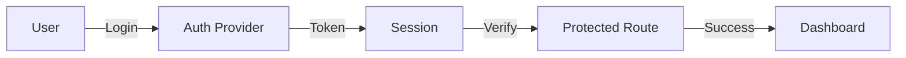

# Day 22: Authentication

## 📚 Aaj Kya Seekhoge?
- Authentication concepts
- NextAuth.js (Auth.js)
- Session management
- Protected routes

---

## 🔐 Authentication Overview



---

## 📦 Install Auth.js

```bash
npm install next-auth@beta @auth/prisma-adapter @prisma/client
npm install prisma --save-dev
npx prisma init
```

---

## 📝 Basic Auth Setup

```tsx
// auth.ts
import NextAuth from "next-auth"
import GitHub from "next-auth/providers/github"
import Google from "next-auth/providers/google"

export const { handlers, signIn, signOut, auth } = NextAuth({
  providers: [
    GitHub,
    Google,
  ],
})

// app/api/auth/[...nextauth]/route.ts
import { handlers } from "@/auth"
export const { GET, POST } = handlers
```

---

## 🔒 Protected Page

```tsx
// app/dashboard/page.tsx
import { auth } from '@/auth';
import { redirect } from 'next/navigation';

export default async function DashboardPage() {
  const session = await auth();
  
  if (!session) {
    redirect('/api/auth/signin');
  }
  
  return (
    <div className="p-4">
      <h1 className="text-3xl font-bold mb-4">Dashboard</h1>
      <p>Welcome, {session.user?.name}!</p>
      <p>Email: {session.user?.email}</p>
    </div>
  );
}
```

---

## 🎯 Aaj Ka Summary

| Concept | Code | Use Case |
|---------|------|----------|
| Provider | `GitHub, Google` | Social login |
| Session | `auth()` | Get user |
| Protected | `if (!session) redirect()` | Auth check |

---

## ✅ Next Steps
- Kal hum **Database with Prisma** seekhenge
- Aaj ke practice problems solve karo
